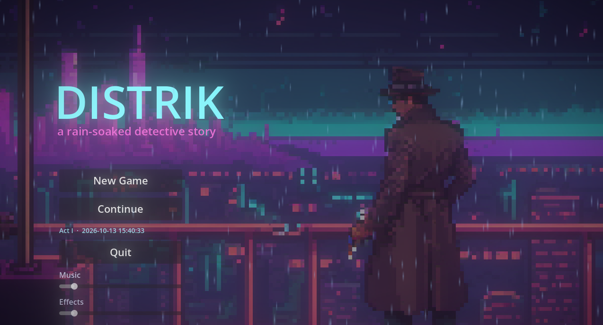
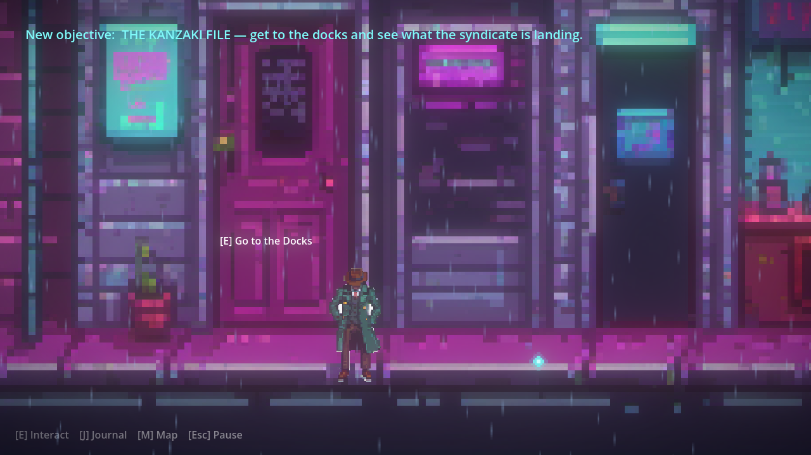
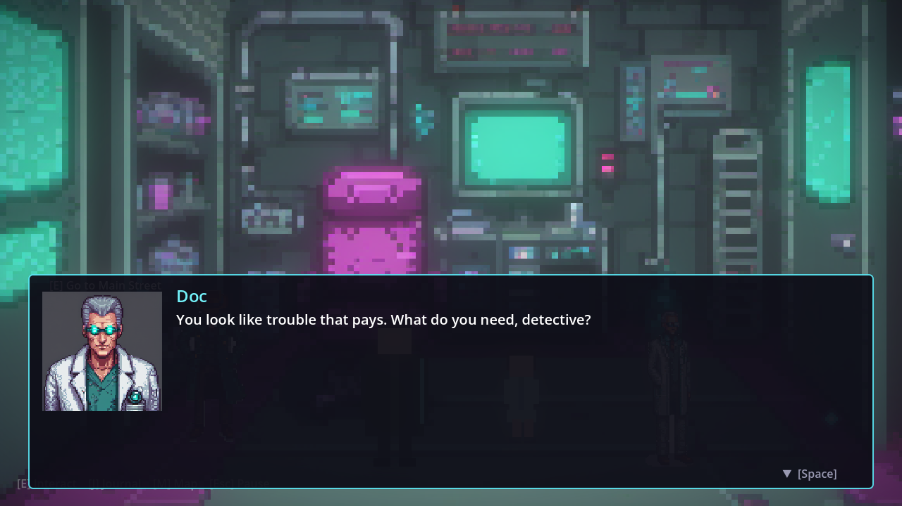
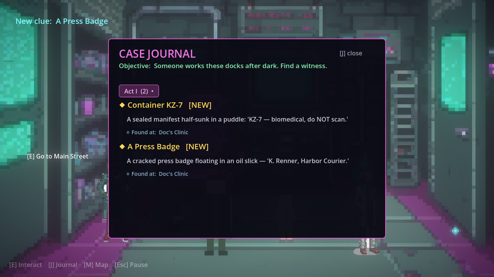
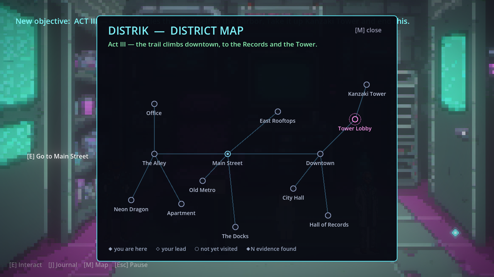
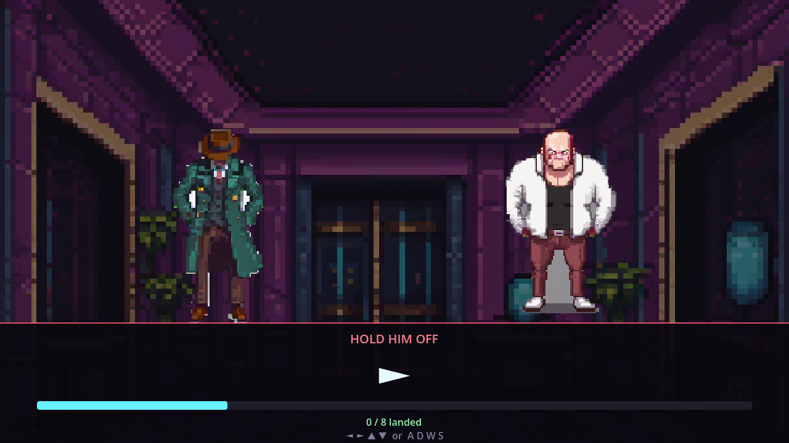
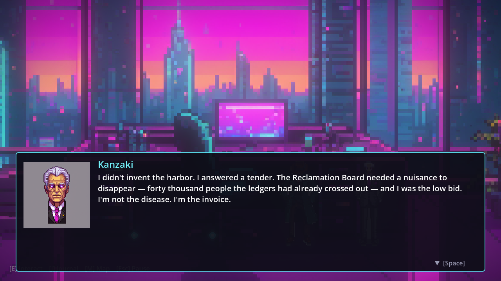

# DISTRIK

**A rain-soaked cyberpunk detective story.** *The rain hasn't stopped in nine years.*

DISTRIK is a narrative detective **side-scroller** built in **Godot 4.6**. You walk a drowning
neon-noir district, question the people the city has already written off, examine clues, and solve a
murder that runs deeper than anyone wants you to look. It plays on atmosphere and writing rather than
combat — though the detective's failing cyberware will get one chance to throw a punch.

> ⚠️ **Prototype.** This is a playable vertical slice — full story start to finish, but rough edges,
> placeholder-grade art/audio, and work-in-progress polish.



---

## The case

A John Doe turns up in the alley off Kessler Street. Following a matchbook and a whistleblower's letter,
you tie the killing to the **Kanzaki** syndicate and the banned neuroagent it's been sinking in the
harbor — poisoning the low districts a glass of water at a time. But the deeper you dig, the clearer it
gets that the villain isn't a man. It's a line item. Solving the case is one thing. Living with what
"solved" turns out to mean is another.

A short **Prologue** eases you in; the main case, **The Kanzaki File**, runs three acts and **six
distinct endings** that react to how thoroughly you investigated and what you chose to do with the truth.

| | |
|---|---|
|  |  |
| Explore a hand-painted neon district | Branching, portrait-driven dialogue |
|  |  |
| A case journal, tabbed by act | An act-aware district map |
|  |  |
| An optional cyberware-glitch QTE brawl | A morally-grey confrontation & twist |

---

## Features

- **~14 explorable locations** across a connected district — streets, docks, a clinic, rooftops, a
  records hall, a subway, City Hall, and the tower at the top of it all.
- **Evidence-gated investigation** — progress is driven by the clues and confessions you actually find.
- **Case journal** ([J]) tabbed by Prologue / Act I–III, with "where found" tags and new-clue markers.
- **District map** ([M]) that reveals itself act by act and tracks visited locations and evidence.
- **Six endings** plus a personalized case-file recap and epilogue beats keyed to your choices.
- **An optional reflex QTE** against an enforcer — the protagonist's decaying cyberware glitches the
  prompts, so his own body works against him.
- **Autosave**, a Continue-with-save-summary menu, adjustable text speed, and audio sliders.

## Controls

| Action | Keys |
|---|---|
| Move | `A` / `D` or `←` / `→` |
| Jump | `Space` / `W` / `↑` |
| Interact | `E` |
| Advance dialogue | `Space` / `Enter` / `E` |
| Case journal | `J` / `Tab` |
| District map | `M` |
| Pause / options | `Esc` |

## Running it

1. Install **[Godot 4.6](https://godotengine.org/)** (standard build, no C# needed).
2. Clone this repo and open `project.godot` in Godot — it will reimport assets on first open (a minute or two).
3. Press **Play** (F5). The game boots to the main menu; choose **New Game**.

No build step or external dependencies.

## Project layout

```
assets/        pixel-art backgrounds, character models, portraits, audio
data/dialogues/  JSON dialogue trees
scenes/        Boot, MainMenu, player, levels, interactables
scripts/
  globals/     autoload singletons: Game, Scenes, Dialogue, Cases, Audio,
               Atmosphere, Save, Narrator, Pause, Atlas (map), Combat (QTE)
  levels/      Level.gd (parametric room setup)
  interactables/  NPC, Clue, Exit, Finale
docs/          screenshots
PLAN.md        design notes, narrative bible & dev log
```

## Credits & assets

- **Engine:** Godot 4.6.
- **Pixel art** (backgrounds, character models, portraits) was generated with a local
  **Stable Diffusion XL + Pixel-Art-XL LoRA** pipeline, then cleaned and composited for the game.
- **Music & ambience:** from a third-party audio pack — see `assets/audio/music/License.txt`.

## Status & license

A solo-dev prototype, shared for feedback and as a work-in-progress portfolio piece. Code is free to
read and learn from. Generated art is usable; bundled audio remains under its pack's own license (see
above) — swap it before any commercial use.
